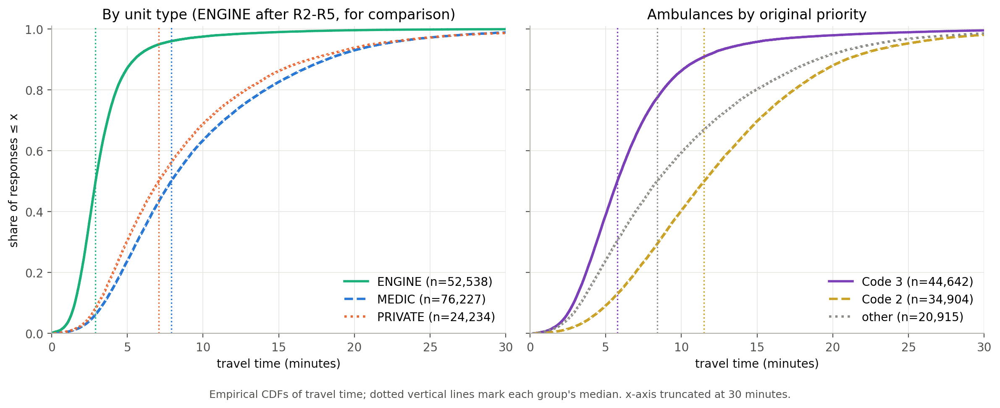
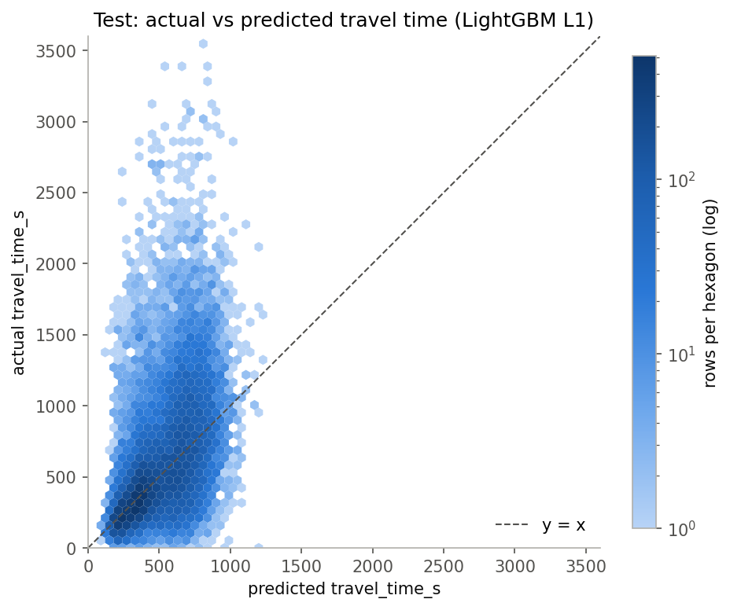

# San Francisco ambulance travel time at dispatch

**Summary.** On 100,461 San Francisco ambulance responses from 2025, a LightGBM model predicts travel time at dispatch with test MAE 214.7 s. The best simple baseline (median by station area × priority) gets 230.6 s, so the gain is a modest ~7%, but it is consistent across priority groups, unit types and 10 held-out spatial regions. Conformalized 80% intervals reach 79.5% test coverage and are ~6% narrower than the baseline's, but are still about 11 minutes wide. The main limitation is that the ambulance's starting location is unknown.


*Empirical CDFs of travel time (minutes, cleaned 2025 data). Engines after R2–R5; ambulances after R1–R7. Dotted lines mark group medians.*

## 1. Question

Can ambulance travel time (en route → on scene) be predicted at the moment a unit is dispatched? This is a small open-data analogue of ambulance driving-time research, built on San Francisco Fire Department dispatch records.

## 2. Data

- **Source.** DataSF dataset [`nuek-vuh3`](https://data.sf.gov/d/nuek-vuh3), *Fire Department and Emergency Medical Services Dispatched Calls for Service* (SFFD computer-aided dispatch). Published under the **Open Data Commons Public Domain Dedication and License (PDDL)**. Credit: City and County of San Francisco, DataSF.
- **Extract.**
  - Calls received in 2025 with `call_type = 'Medical Incident'`.
  - Units of type MEDIC, ENGINE or PRIVATE, with a recorded `on_scene_dttm`.
  - 158,492 unit responses in total.
- **What is modelled.** MEDIC and PRIVATE ambulances only. ENGINE rows are used only for comparison.
- **The data is not in this repository.** Download it with the command in [Reproduce](#10-reproduce). The query was checked to reproduce the analysed file row for row. DataSF may revise records over time.

Exact download URL:

```
https://data.sf.gov/resource/nuek-vuh3.csv?$select=call_number,unit_id,unit_type,call_type_group,original_priority,priority,final_priority,als_unit,received_dttm,dispatch_dttm,response_dttm,on_scene_dttm,station_area,battalion,box,unit_sequence_in_call_dispatch,call_final_disposition,neighborhoods_analysis_boundaries,case_location&$where=received_dttm%20between%20%272025-01-01T00%3A00%3A00%27%20and%20%272025-12-31T23%3A59%3A59%27%20AND%20call_type%3D%27Medical%20Incident%27%20AND%20unit_type%20in%28%27MEDIC%27,%27ENGINE%27,%27PRIVATE%27%29%20AND%20on_scene_dttm%20IS%20NOT%20NULL&$limit=200000
```

## 3. Target and prediction moment

- **Target:** `travel_time_s = on_scene_dttm − response_dttm`, in seconds.
- **Prediction moment:** the unit's dispatch. Features are restricted to information available at that moment.

Excluded fields, and why:

| field | reason |
|---|---|
| `priority`, `final_priority` | Later reassessments. 17% of responses with original priority 2 end with final priority 3. |
| `call_type_group` | When it is assigned is undocumented. |
| `call_final_disposition` | An outcome of the call. |
| `response_dttm`-derived turnout time, `on_scene_dttm` | After the prediction moment (`on_scene_dttm` is the target). |
| `month` | With a time split, test months never appear in training. |
| `box`, `neighborhoods_analysis_boundaries` | Many thin levels or redundant with coordinates; when neighborhoods are assigned is unconfirmed. |

## 4. Cleaning

The rules are applied in order ([`src/clean.py`](src/clean.py)):

| rule | description | rows removed | rows after | justification |
|---|---|---:|---:|---|
| R1 | keep MEDIC, PRIVATE | 54,553 | 103,939 | The target is ambulance travel. |
| R2 | drop missing lat/lon/station_area/box | 4 | 103,935 | Location is needed and can't be imputed honestly. |
| R3 | drop travel time ≤ 0 s | 3,201 | 100,734 | Arrival cannot precede departure. |
| R4 | drop dispatch < received or response < dispatch | 16 | 100,718 | Out-of-order timestamps. |
| R5 | drop [received, on_scene] overlapping a 2025 DST transition | 35 | 100,683 | See DST evidence below. |
| R6 | drop travel time ≤ 10 s | 197 | 100,486 | See the 1–10 s spike below. |
| R7 | drop travel time > 3,600 s | 25 | 100,461 | Over an hour is not a credible drive within the city. Only 25 rows; on test, dropping vs keeping them changes RMSE by about 5 s for every model and does not change the ranking (stage 3 sensitivity). |

Evidence behind R3, R5 and R6:
- **R3:** 5,182 of the 5,200 non-positive travel times in the raw file are exactly 0.
- **R5 (DST):**
  - 7 of the 18 negative travel times in the raw file fall in the 2025-11-02 fall-back window, between −2,279 s and −3,362 s, close to the one-hour shift.
  - Two rows in the spring-forward window show 7,958 s and 4,172 s. The clock skipped 02:00–03:00, so elapsed time computed across it is inflated by one hour (e.g. 4,172 − 3,600 = 572 s of real travel).
- **R6:** after R1–R5, the 1–10 s bin holds 197 rows, against 87 and 90 in the 11–20 s and 21–30 s bins. This is the same artefact as exact zeros: en route and on scene pressed almost together.

A hypothesis that timestamps are rounded to the minute by hand was rejected. `on_scene_dttm` has seconds = 0 in 1.60–2.07% of rows by unit type, close to the 1.67% expected without rounding.

## 5. Method

- **Baselines** (medians fitted on training data). A cell with fewer than 30 training rows falls back to the next coarser level.
  - B0: global median.
  - B1: median by `original_priority_cat`.
  - B2: median by `station_area` × `original_priority_cat`.
- **Model.** LightGBM with an L1 objective, so it predicts the conditional median. Features:
  - `lat`, `lon`
  - `original_priority_cat`, `station_area`, `battalion`, `unit_type` (categorical)
  - `als_unit`, `unit_sequence_in_call_dispatch`
  - hour and day of week of `received_dttm`
  - `workload_60m`: distinct calls in the raw file received in the 60 minutes **strictly before** this call. A call at the same timestamp, or the call itself, is not counted; this is asserted on a hand-made example.
- **Tuning.** Hyperparameters were chosen on the validation month from a 6-config grid (all within 0.4 s of each other in validation MAE). The final model was refit on train+valid.
- **Intervals (80%).** Two LightGBM quantile models (α = 0.1, 0.9) are fit on the training months, then conformalized (CQR) on the validation month: `[lo − q, hi + q]`.

## 6. Validation design

- **Time split on `received_dttm`.** Test is used once, for the final evaluation.

  | split | months | rows | calls |
  |---|---|---:|---:|
  | train | Jan–Aug | 66,943 | 66,358 |
  | valid | Sep | 8,266 | 8,195 |
  | test | Oct–Dec | 25,252 | 25,027 |

- **Grouped by `call_number`.** Units on the same call never straddle splits or folds.
- **Paired bootstrap on test, resampling calendar days** (92 days). Calls on the same day share conditions, so days are treated as the independent unit. The CI reflects sampling variation over test days for fixed fitted models, not variation from refitting.
- **Spatial block CV on train+valid.** KMeans on coordinates gives 10 contiguous blocks, and each fold holds out one block.

## 7. Results

**Test point metrics** (seconds; within ±120 s in %):

| | MAE | RMSE | MedAE | P90AE | within ±120 s |
|---|---:|---:|---:|---:|---:|
| B0 global median | 279.4 | 403.8 | 198.0 | 634.9 | 31.0 |
| B1 priority | 240.1 | 353.9 | 165.0 | 514.0 | 38.3 |
| B2 station × priority | 230.6 | 346.6 | 151.0 | 507.5 | 41.8 |
| LightGBM L1 | 214.7 | 332.5 | 132.4 | 490.2 | 46.5 |


*Predicted (LightGBM, L1) vs actual travel time on the test set (Oct–Dec 2025).*

**Day-level paired bootstrap, B2 − model** (positive = model better):

| | estimate | 95% CI |
|---|---:|---:|
| MAE difference | 15.9 | [14.8, 17.0] |
| RMSE difference | 14.1 | [12.7, 15.5] |

**Spatial block CV** (MAE across 10 held-out blocks):

| | mean | std | min | max |
|---|---:|---:|---:|---:|
| LightGBM L1 | 223.3 | 14.7 | 205.5 | 253.8 |
| B2 | 240.9 | 19.6 | 209.0 | 275.8 |
| B2 − model | 17.6 | 6.9 | 3.6 | 27.6 |

**80% intervals on test** (coverage % / mean width in s):

| segment | raw QR | CQR | B2 empirical |
|---|---:|---:|---:|
| all | 77.7 / 623.4 | 79.5 / 641.7 | 79.3 / 683.8 |
| MEDIC | 77.7 / 623.6 | 79.6 / 641.9 | 79.9 / 682.2 |
| PRIVATE | 77.8 / 622.6 | 79.4 / 640.9 | 77.7 / 688.9 |
| priority 2 | 77.9 / 860.2 | 79.0 / 878.4 | 78.9 / 904.9 |
| priority 3 | 77.6 / 379.9 | 80.0 / 398.2 | 79.6 / 448.8 |
| other | 77.7 / 751.1 | 79.5 / 769.4 | 79.5 / 820.8 |

**Error breakdown on test** (model MAE, P90AE; CQR coverage %):

| segment | n | MAE | P90AE | CQR coverage |
|---|---:|---:|---:|---:|
| priority 2 | 8,988 | 288.2 | 594.4 | 79.0 |
| priority 3 | 11,329 | 141.7 | 286.2 | 80.0 |
| other | 4,935 | 248.4 | 547.5 | 79.5 |
| 00–06 h | 4,646 | 196.1 | 441.3 | 79.2 |
| 07–18 h | 15,252 | 226.0 | 519.4 | 79.5 |
| 19–23 h | 5,354 | 198.6 | 443.4 | 79.8 |

**CQR exceedance on test** (target about 10% each side):

| segment | actual above upper | actual below lower |
|---|---:|---:|
| all | 11.5% | 9.0% |
| priority 2 | 11.9% | 9.1% |
| priority 3 | 11.3% | 8.7% |
| other | 11.1% | 9.4% |

## 8. Findings

- **The improvement over the best simple baseline is modest but consistent.** Test MAE falls from 230.6 s (B2) to 214.7 s, about 7%. The model has lower MAE than B2:
  - in every priority group (288.2 vs 301.0, 141.7 vs 157.9, 248.4 vs 269.3);
  - for both unit types (MEDIC 213.6 vs 230.6, PRIVATE 218.1 vs 230.8);
  - in all 10 held-out spatial blocks (gains of 3.6 to 27.6 s).
- **Engines are much faster and less variable than ambulances.** Engines (after R2–R5) have a median of 174 s and a 90th percentile of 328 s, against 473 s and 1,091 s for MEDIC (after R1–R5). Engines usually start from a nearby station, while an ambulance's starting point varies. This is why ambulance travel time is the harder problem.
- **Priority dominates; incident location adds little.**
  - Permutation importance on test: shuffling `original_priority_cat` raises MAE by 77.2 s. Shuffling `lat` or `lon` raises it by 3.5 s and 2.7 s, and `station_area` by 11.1 s.
  - This is consistent with the ambulance's starting point being unknown: the incident location alone does not fix the distance driven.
- **Dispatch order is informative and interacts with priority.**
  - `unit_sequence_in_call_dispatch` is the ambulance's position among all units assigned to the call; for most ambulances ranked second, the unit assigned first was not an ambulance in our data. Shuffling it raises MAE by 23.8 s.
  - On priority 3 calls, an ambulance assigned first has a median travel time of 242 s, and one assigned second 388 s. On priority 2 calls the pattern reverses (710 s vs 533 s).
  - For priority 3 this is consistent with an engine being sent first when no ambulance is close, but that mechanism is not tested here. The priority 2 pattern is unexplained.
  - The variable reflects dispatch decisions, not geography alone.
- **`workload_60m` contributes little:** validation MAE is 216.1 s with it vs 216.9 s without, and its test permutation importance is 3.6 s.
- **80% intervals have near-nominal coverage and are narrower than the baseline's, but still wide.**
  - The CQR intervals are 641.7 s wide on average, against 683.8 s for B2 (about 6% narrower; about 11% for priority 3: 398.2 vs 448.8 s).
  - 641.7 s is still about 11 minutes, more than the median ambulance trip (473 s MEDIC, 423 s PRIVATE). Uncertainty is large relative to a typical trip.
  - Misses are lopsided: actual trips exceed the upper bound 11.5% of the time (nominal 10%) and fall below the lower bound 9.0%. This holds in every priority group. So the intervals slightly understate the risk of long trips, which is the side that matters for dispatch.
- **For PRIVATE units the model does not improve the 90th-percentile error:** P90AE is 502.3 s against 484.0 s for B2, and RMSE barely changes (352.6 vs 354.7 s).

## 9. Limitations

- **The ambulance's origin is unknown.** This is the main limit: the data gives the incident location, not where the unit started.
- **Locations are coarse:** they are at intersection level.
- **Timestamps are recorded by crews.**
  - 3.1% of ambulance rows have travel time ≤ 0, almost all exactly 0. The rate is higher for PRIVATE (6.3%) than MEDIC (2.0%).
  - Excluding them may bias the data toward longer trips, if zeros are more common on short trips. That cannot be tested here.
- **The data is conditional on the unit arriving.** The extract requires `on_scene_dttm`, so cancelled responses are absent. `workload_60m` likewise undercounts calls that were cancelled before arrival.
- **One year, one city.** San Francisco is not rural Northern Sweden; this is an analogue, not a replica.
- **CQR coverage is marginal** (not per subgroup) and assumes calibration and test rows are exchangeable. A time split only approximates this. The validation month also chose the quantile models' iteration counts, a mild reuse.

## 10. Reproduce

Python 3.9. On macOS, LightGBM needs OpenMP: `brew install libomp`.

```bash
python3 -m venv .venv
source .venv/bin/activate
pip install -r requirements-lock.txt

mkdir -p data/raw
curl -sLG 'https://data.sf.gov/resource/nuek-vuh3.csv' \
  --data-urlencode '$select=call_number,unit_id,unit_type,call_type_group,original_priority,priority,final_priority,als_unit,received_dttm,dispatch_dttm,response_dttm,on_scene_dttm,station_area,battalion,box,unit_sequence_in_call_dispatch,call_final_disposition,neighborhoods_analysis_boundaries,case_location' \
  --data-urlencode "\$where=received_dttm between '2025-01-01T00:00:00' and '2025-12-31T23:59:59' AND call_type='Medical Incident' AND unit_type in('MEDIC','ENGINE','PRIVATE') AND on_scene_dttm IS NOT NULL" \
  --data-urlencode '$limit=200000' \
  -o data/raw/nuek-vuh3.csv

# reports, in order (run from the project root)
python -m src.inspect_raw > reports/stage0_raw_report.txt
python -m src.diagnostics     # reports/stage1_diagnostics.txt
python -m src.clean           # data/processed/ambulance_clean.parquet
python -m src.baselines       # reports/stage2_baselines.txt
python -m src.model           # reports/stage3_results.txt
python -m src.stage4          # reports/stage4_results.txt

# notebooks, in order
for nb in 01_cleaning_eda 02_splits_baselines 03_model 04_intervals_errors; do
  jupyter nbconvert --to notebook --execute --inplace notebooks/$nb.ipynb
done
```

Code lives in [`src/`](src/); the notebooks only call it. Figures are in [`reports/figures/`](reports/figures/).

Descriptive figures: notebooks/05_spatial_overview.ipynb (produced after modelling; no modelling decisions were based on them).
